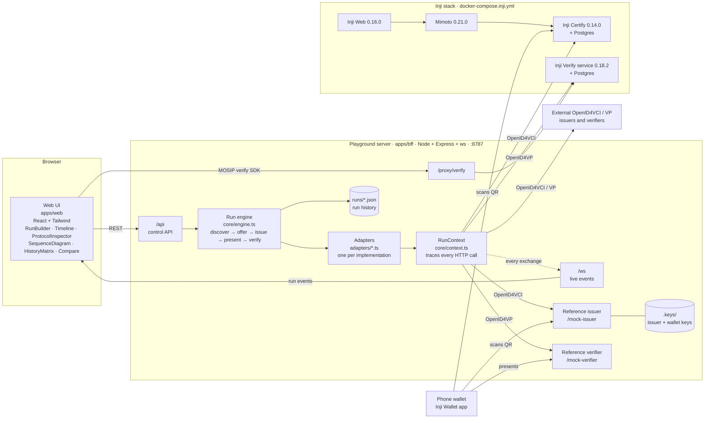
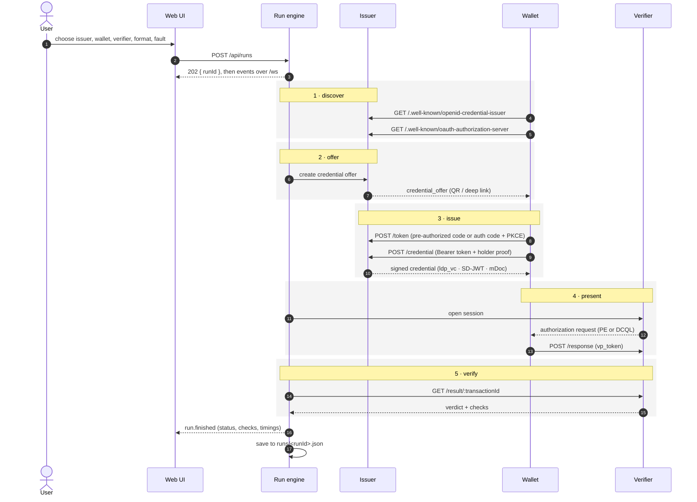

# Architecture

## Components

## One run, end to end

## Why it is built this way

- **Adapters never touch the network directly.** Every request goes through `RunContext`, so the
  protocol inspector is complete by construction, not because each adapter remembers to log.
- **The reference wallet knows only the specifications.** It drives Inji Certify and the reference
  issuer through the same code path, so it works as a control: if it fails against one and passes
  against the other, the difference is in the issuer.
- **One process.** The server also serves the built UI, so a deployment is one container.

Data model and wire types: `packages/shared/src/domain.ts`, `packages/shared/src/protocol.ts`.
Endpoints: [API.md](API.md).
